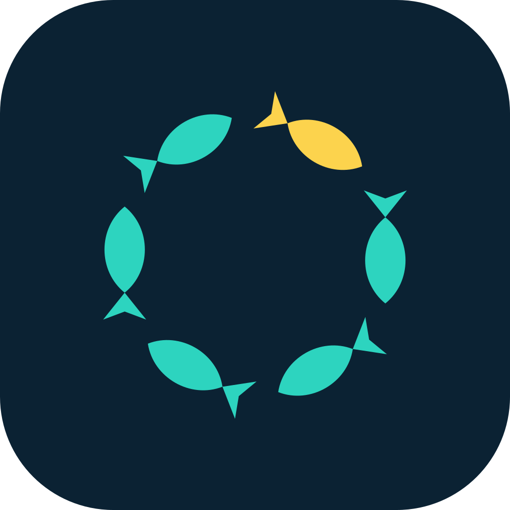
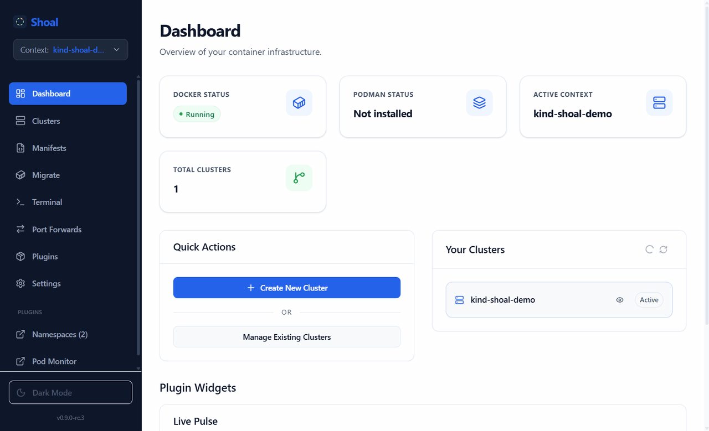
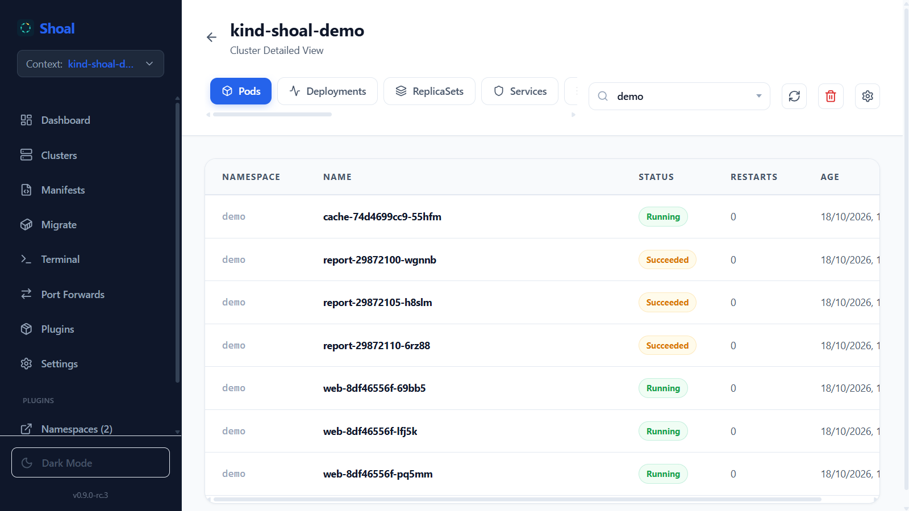
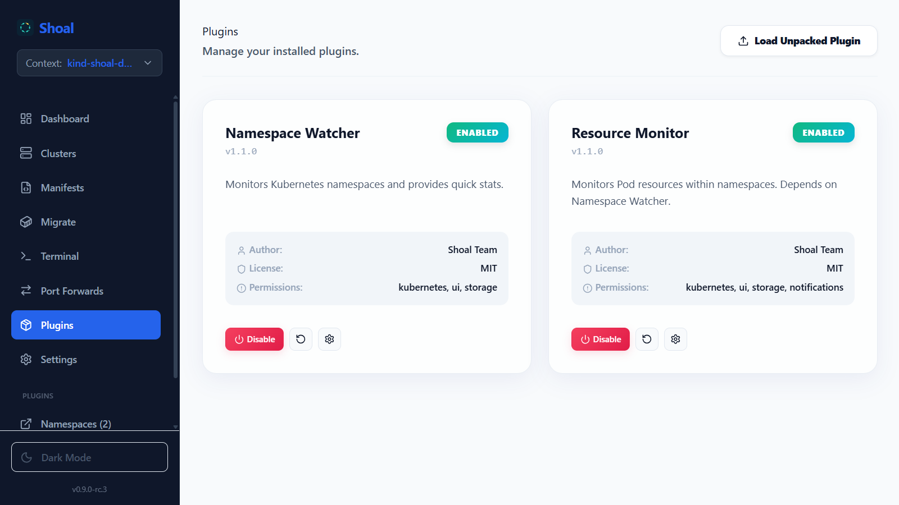

# Shoal



[](COPYING.LESSER)
[](https://github.com/Dangalcan/shoal/releases)
[](https://electronjs.org)
[](https://react.dev)

A desktop app for your Kubernetes clusters: local clusters with kind or k3d, resources, manifests, logs, terminals and port-forwards in one window. Built with Electron, React, TypeScript and Vite.

Website and downloads: [shoal.dangalcan.com](https://shoal.dangalcan.com).

> **Public beta (0.9).** Windows and Linux (x64) only; macOS arrives with 1.0. Installers are not code-signed yet, so Windows SmartScreen shows "Windows protected your PC": choose **More info → Run anyway**. The plugin marketplace and paid plugins also arrive with 1.0; the beta ships two bundled plugins. Please report problems on [GitHub Issues](https://github.com/Dangalcan/shoal/issues).



| Cluster resources                                                | Bundled plugins                                |
| ---------------------------------------------------------------- | ---------------------------------------------- |
|  |  |

## 📥 Installation

Download the latest release from [Releases](https://github.com/Dangalcan/shoal/releases). The installers are 64-bit (x64) only.

- **Windows 10 or later:** `Shoal-Setup-<version>.exe` installs per user and updates itself; `Shoal-<version>-portable.exe` needs no install and does not auto-update. Neither is code-signed yet, so SmartScreen shows "Windows protected your PC" on first start: choose **More info → Run anyway**.
- **Linux** (Ubuntu 22.04+ or equivalent, X11 or Wayland): `Shoal-x86_64.AppImage` (`chmod +x` it, then run it) updates itself in place, so desktop shortcuts keep working, and needs `libfuse2` (`libfuse2t64` on Ubuntu 24.04). If you still run a `Shoal-<version>.AppImage` from 0.9.1 or earlier, its next update leaves `Shoal-x86_64.AppImage` in the same folder instead, so your shortcuts need one last fix; rename the file first to a name without a version number (`mv Shoal-0.9.1.AppImage Shoal.AppImage`) and the updater keeps that name. The `.deb` package (`sudo apt install ./shoal_<version>_amd64.deb`) needs no FUSE and does not auto-update. On Ubuntu 24.04 prefer the `.deb`: it installs an AppArmor profile that keeps Chromium's sandbox, which the AppImage has to turn off there.

Shoal drives your clusters through tools you install separately: **kubectl** (required for anything cluster-related; Shoal tells you when it is missing), **kind** or **k3d** plus **Docker** running to create local clusters, and **kompose** (optional) for the Docker Compose migration. The [User Guide](docs/USER_GUIDE.md) covers the rest.

## Table of Contents

- [Installation](#-installation)
- [Features](#-features)
- [Architecture](#-architecture)
- [Project Structure](#-project-structure)
- [Tech Stack](#-tech-stack)
- [Getting Started](#-getting-started)
  - [Prerequisites](#prerequisites)
  - [Development](#development)
- [Plugin System](#-plugin-system)
- [Testing](#-testing)
- [Deployment](#-deployment)
- [Roadmap](#-roadmap)
- [Contributing](#-contributing)
- [Troubleshooting](#-troubleshooting)
- [License](#license)

## ✨ Features

### Cluster Management

- 🚀 Create local clusters with kind or k3d
- 📋 List every kubeconfig context, with the provider shown for kind and k3d clusters
- 🔄 Switch between kubeconfig contexts from the sidebar
- 🗑️ Delete kind and k3d clusters, or remove any other context from the kubeconfig
- 🖥️ Dashboard with the cluster summary and the state of Docker or Podman, and a light or dark theme

### Resource Management

- 👁️ Browse the core resource kinds (Pods, Deployments, Services, ConfigMaps, Secrets, Ingresses, PVCs, RBAC, CRDs and more), with sortable columns and a per-tab column picker
- 🔍 Filter by namespace, with a default namespace in Settings
- 🔁 Auto-refresh with a configurable interval
- 📝 Describe, YAML and recent logs for any resource
- 📡 Live log streaming (Follow, like `kubectl logs -f`) with a container picker and auto-scroll that pauses while you read
- 🔄 Rollout restart for Deployments, DaemonSets, StatefulSets
- ⚖️ Scale Deployments and StatefulSets to any replica count
- 🗑️ Delete any resource directly from the UI

### Manifest Management

- 📄 Save and edit YAML manifests in a built-in editor
- 🗂️ Organize manifests into nested folders (Drive-like hierarchy)
- 📑 Start from ready-made manifest templates (Deployment, Service, ConfigMap, ...)
- 📂 Drag-and-drop YAML/JSON file import
- ▶️ Apply manifests to the active cluster with one click
- 💾 Persisted locally in SQLite

### Migration

- 🚚 Convert `docker-compose.yml` files into Kubernetes manifests via [kompose](https://kompose.io)
- 📥 Import the converted resources into the manifest library for review before applying

### Terminal

- 💻 Local shell sessions with a shell picker (PowerShell, PowerShell 7, Command Prompt, Git Bash, WSL on Windows; bash, zsh, sh on Linux)
- 🐚 Pod exec (`kubectl exec -it`) sessions inside any running container, with a TTY
- ⏹️ Local shells run in a real pseudo-terminal: prompt, line editing, Ctrl+C, resize and full-screen programs such as `vim`, `less` or `k9s`

### Port Forwarding

- 🔌 Start and stop `kubectl port-forward` tunnels to pods and services
- 📡 Manage all active tunnels from a dedicated page, with automatic notification when a tunnel dies

### Plugin System (Beta)

- 🔌 Extensible plugin architecture with sandboxed plugin UI
- 🔐 Plugin signing and verification covering every file of a plugin
- 🎨 UI extensions (sidebar items, pages, resource actions, dashboard widgets, modals)
- 📦 Two bundled example plugins, Namespace Watcher and Resource Monitor
- 🛒 Planned for 1.0: the marketplace, paid plugins and licenses

### App Updates

- ⬆️ In-app auto-update via `electron-updater` and GitHub Releases (Windows installer and AppImage)

### Developer Tools

- 🧪 Test suite with coverage thresholds enforced in CI (97% lines, 95% branches)
- 📚 Detailed contribution guides
- 🎯 Type-safe IPC communication
- 🔧 Hot-reload development mode

## 🏗 Architecture

**Shoal** follows a secure, multi-process architecture typical of Electron applications:

1.  **Main Process** (`electron/`):
    - Runs the application lifecycle (window creation, app events).
    - Acts as the secure bridge to the operating system.
    - Executes shell commands (like `docker`, `podman`, `kind`) via Node.js `child_process`.
    - Exposes limited, secure capabilities to the UI via **IPC** (Inter-Process Communication).

2.  **Renderer Process** (`src/`):
    - Runs the React UI.
    - **Sandboxed**: No direct access to Node.js APIs (fs, child_process, etc.).
    - Communicates with the Main Process using the `window.electron` bridge defined in `preload.ts`.

### IPC Bridge Pattern

The frontend requests actions (like "Check Docker Status") by calling:
`window.electron.getToolStatus('docker')`

This is routed securely:
`UI (React) -> preload.ts -> IPC Channel -> Main Process (executes command) -> IPC Response -> UI`

## 📂 Project Structure

```bash
shoal/
├── electron/               # ⚡ Main Process Source
│   ├── main.ts            # Entry point, window setup, navigation guards
│   ├── preload.ts         # ContextBridge — secure IPC surface
│   ├── database.ts        # SQLite setup (manifests)
│   ├── logger.ts          # electron-log setup (main.log)
│   ├── ipc/               # IPC handler modules (cluster, resources, logs, plugins, manifests, migration, terminal, portforward, update, app)
│   ├── services/          # Business logic
│   │   ├── cluster/       # Kind/K3d cluster management
│   │   ├── kubernetes/    # kubectl API wrapper and read cache
│   │   ├── logs/          # kubectl logs -f streams (log viewer Follow mode)
│   │   ├── helm/          # helm CLI wrapper (used by the plugin SDK)
│   │   ├── plugins/       # Plugin manager, loader, registry, context, events, sandbox, utility-process host
│   │   ├── marketplace/   # Marketplace HTTP client (hidden in 0.9)
│   │   ├── migration/     # Docker Compose → Kubernetes conversion (kompose)
│   │   ├── portforward/   # kubectl port-forward tunnel manager
│   │   ├── settings/      # app-settings.json (kubeconfig path)
│   │   ├── terminal/      # Local & pod-exec shell sessions
│   │   ├── tools/         # kubectl, kind, k3d, Docker, Podman, kompose detection
│   │   ├── update/        # electron-updater integration
│   │   └── security/      # License manager, signature verification, encryption
│   ├── shared/            # Code shared with the renderer (plugin-file URLs)
│   ├── utils/             # safe-exec, path helpers, Windows PATH refresh
│   ├── data/              # Sample marketplace catalog for development
│   ├── __tests__/         # Main-process unit tests (Vitest)
│   ├── types/             # Shared TypeScript types (plugin-types.ts, migration-types.ts, ...)
│   └── tsconfig.json      # Main process TS config
├── src/                    # ⚛️ Renderer Source (React)
│   ├── components/        # Reusable UI components (tables, modals, sidebar, terminal)
│   ├── features/          # Feature modules (clusters, logs, manifests, migration, plugins, portforward, settings, terminal, updates)
│   ├── hooks/             # Custom React hooks
│   ├── layouts/           # Page layouts
│   ├── pages/             # Route-level components (Dashboard, Clusters, Manifests, Migration, Plugins, PortForwards, Terminal, Settings)
│   ├── services/          # Frontend API service layer & plugin UI registry
│   ├── types/             # Frontend TypeScript interfaces
│   ├── lib/               # Utilities and resource definitions
│   ├── test/              # Renderer unit tests (Vitest + Testing Library)
│   ├── App.tsx            # React Router setup
│   └── main.tsx           # React entry point
├── plugins/               # 🔌 Bundled example plugins (namespace-watcher, resource-monitor)
├── public/                # Static assets, app icon, sandboxed plugin host page
├── styles/                # 🎨 SCSS stylesheets (variables, animations, components)
├── e2e/                   # 🎭 Playwright end-to-end tests and the screenshot capture (npm run screenshots)
├── scripts/               # 🔧 Build and utility scripts (plugin signing, third-party notices)
├── docs/                  # 📚 Guides (user, plugins, API, release, testing)
├── .github/               # CI, release, gitleaks and CodeQL workflows, issue forms, Dependabot
├── dist-electron/          # 📦 Compiled Main Process (output)
├── dist/                   # 📦 Compiled Renderer (output)
├── package.json           # Dependencies, npm scripts and the electron-builder config
├── vite.config.ts         # Vite renderer build config
├── vitest.config.ts       # Unit test configuration
├── playwright.config.ts   # E2E test configuration
├── tailwind.config.cjs    # Tailwind CSS v4 configuration
└── postcss.config.cjs     # PostCSS config (Tailwind adapter)
```

## 🛠 Tech Stack

- **Runtime**: [Electron](https://www.electronjs.org/)
- **Frontend**: [React 19](https://react.dev/)
- **Language**: [TypeScript](https://www.typescriptlang.org/)
- **Build Tool**: [Vite](https://vitejs.dev/) + [electron-builder](https://www.electron.build/)
- **Styling**: [Tailwind CSS v4](https://tailwindcss.com/) + SCSS
- **Icons**: [Lucide React](https://lucide.dev/)
- **Routing**: [React Router v7](https://reactrouter.com/)
- **Database**: [better-sqlite3](https://github.com/WiseLibs/better-sqlite3) (manifests & plugin key-value storage)
- **Terminal**: [xterm.js](https://xtermjs.org/) over [node-pty](https://github.com/microsoft/node-pty) pseudo-terminals, for local shells and `kubectl exec` alike (plain pipes only without node-pty)
- **Auto-Update**: [electron-updater](https://github.com/electron-userland/electron-builder/tree/master/packages/electron-updater) (GitHub Releases)
- **Notifications**: [Sonner](https://sonner.emilkowal.ski/) (toasts)
- **Testing**: [Vitest 5](https://vitest.dev/) (unit) + [Playwright](https://playwright.dev/) (E2E)

## 🚀 Getting Started

### Prerequisites

To use Shoal, see [Installation](#-installation). To develop it:

- **Node.js** v22.12+ ([Download](https://nodejs.org/)), see `.nvmrc`
- **npm** v9+ (comes with Node.js)

### Development

1.  Install dependencies, then set up the git hooks once:

    ```bash
    npm install
    npm run prepare
    ```

    No C++ toolchain is needed on Windows. The project `.npmrc` turns
    dependency install scripts off (better-sqlite3 and node-pty ship prebuilt
    binaries for Windows), so npm does not run the `prepare` hook by itself.
    On Linux node-pty has no prebuilt binary: run `npm run rebuild:node-pty`
    once (needs `make`, `g++` and `python3`) so local terminals get a
    pseudo-terminal; without it they run over pipes.

2.  Run the development server (starts React and Electron; development builds also load unsigned plugins and show the hidden Marketplace tab with bundled sample data):

    ```bash
    npm run dev
    ```

### Production Build

To verify that the application compiles correctly for production:

```bash
npm run build
```

This produces the distribution files in `dist/` and `dist-electron/`.

## 🔌 Plugin System

Shoal has a plugin system that lets developers extend the app. A plugin is a Node entry (`index.js`, run in a sandbox or in its own utility process) plus an optional UI (`renderer.js`, run in a sandboxed iframe behind the permission-gated `window.k8sPlugin` API).

In the 0.9 beta, installed builds only run plugins signed with the Shoal key, which means the two bundled examples. Third-party plugins load in development builds (`npm run dev`); signing them through the marketplace arrives with 1.0.

### Plugin Capabilities

Plugins can:

- Add sidebar navigation items
- Register custom pages, dashboard widgets and modals
- Add resource action buttons
- Read cluster resources, logs and metrics through kubectl
- Change resources, apply manifests and drive Helm, each behind its own permission (Secret data needs one more)
- Store persistent data and declared, validated settings
- Show notifications

### For Plugin Developers

See the [Plugin Developer Guide](docs/PLUGINS_GUIDE.md) for detailed information on creating plugins.

**Example Plugin Structure:**

```javascript
module.exports = {
  activate: (context) => {
    // Register UI elements
    context.ui.registerSidebarItem({
      id: 'my-plugin',
      label: 'My Plugin',
      route: '/plugin/my-plugin',
    });

    // Show notification
    context.ui.showNotification('Plugin activated!', 'success');
  },

  deactivate: () => {
    console.log('Plugin deactivated');
  },
};
```

For the architecture (sandbox, isolation, signing), see [Plugin Architecture](docs/PLUGIN_ARCHITECTURE.md).

## 🧪 Testing

Shoal maintains high test coverage standards:

| Metric     | Minimum Threshold |
| ---------- | ----------------- |
| Lines      | 90%               |
| Statements | 90%               |
| Functions  | 90%               |
| Branches   | 80%               |

### Running Tests

```bash
# Run all tests
npm run test

# Watch mode
npx vitest

# Coverage report
npm run test:coverage

# Type-check the test files (CI runs this too)
npm run typecheck:test

# UI mode
npm run test:ui
```

For more information, see the [Testing Guide](docs/CONTRIBUTING_TESTS.md).

## 📦 Deployment

### Building for Production

```bash
npm run build
```

This creates:

- `dist/` - Compiled renderer (React app)
- `dist-electron/` - Compiled main process
- Platform-specific installers (via electron-builder)

### Platform-Specific Builds

```bash
# Windows
npm run build:win

# Linux
npm run build:linux
```

### Distribution

The build process creates platform-specific installers:

- **Windows:** NSIS installer and portable `.exe`
- **Linux:** `.AppImage` and `.deb`

Releases are built and published by CI from `v*` tags; see [docs/RELEASE.md](docs/RELEASE.md), which also records how the repository is configured (required checks, tag protection, security features).

## 🗺 Roadmap

- **0.9.x** (beta fixes): keyboard access to every table and card and whatever the beta feedback shows first. 0.9.1 already split the plugin permissions (reads, writes, Helm and Secret data as separate grants) and moved plugin secrets to the OS keystore. Report what you miss on [GitHub Issues](https://github.com/Dangalcan/shoal/issues).
- **1.0** (planned for Q1 2027): code-signed installers (no more SmartScreen warning), macOS builds, the plugin marketplace with third-party and paid plugins.
- **Marketplace** (planned for 1.0): the marketplace client (catalog, installs, trials, licenses and checkout) is in the code base but hidden in the 0.9 beta: the Marketplace tab only appears when the app runs with `MARKETPLACE_ENABLED=true`, which `npm run dev` sets. It talks to a separate backend that is not public yet, selected through `MARKETPLACE_BACKEND_URL`; without one, development builds fall back to the sample catalog in `electron/data/marketplace.json`.
- **Not planned**: telemetry or accounts. Shoal works offline and sends nothing anywhere except the update check against GitHub Releases.

What changed in each version is in [CHANGELOG.md](CHANGELOG.md). How to contribute, how to report a vulnerability and how we treat each other: [CONTRIBUTING.md](CONTRIBUTING.md), [SECURITY.md](SECURITY.md) and [CODE_OF_CONDUCT.md](CODE_OF_CONDUCT.md).

## 🤝 Contributing

We welcome contributions! Please see our contribution guides:

- [Feature Development Guide](docs/CONTRIBUTING_FEATURES.md)
- [Styling Guide](docs/CONTRIBUTING_STYLES.md)
- [Testing Guide](docs/CONTRIBUTING_TESTS.md)
- [Plugin Development Guide](docs/PLUGINS_GUIDE.md)

### Quick Start for Contributors

1. Fork the repository
2. Clone your fork: `git clone https://github.com/YOUR_USERNAME/shoal.git`
3. Install dependencies and the git hooks: `npm install && npm run prepare`
4. Create a branch: `git checkout -b feature/your-feature`
5. Make your changes
6. Run tests: `npm run test`
7. Run linter: `npm run lint:fix`
8. Commit your changes: `git commit -m "feat: your feature"`
9. Push to your fork: `git push origin feature/your-feature`
10. Open a Pull Request

### Commit Message Guidelines

We follow [Conventional Commits](https://www.conventionalcommits.org/):

- `feat:` New feature
- `fix:` Bug fix
- `docs:` Documentation changes
- `style:` Code style changes
- `refactor:` Code refactoring
- `test:` Adding or updating tests
- `chore:` Maintenance tasks

## 🔧 Troubleshooting

### Common Issues

**Issue: Windows says "Windows protected your PC"**

The 0.9 installers are not code-signed yet, so SmartScreen warns on first start. Choose **More info → Run anyway**. Download installers only from this repository's [Releases](https://github.com/Dangalcan/shoal/releases); [SECURITY.md](SECURITY.md) explains how to check a file's hash.

**Issue: The AppImage does not start on Linux**

- Make it executable first: `chmod +x Shoal-x86_64.AppImage`
- AppImages need `libfuse2`, which Ubuntu 22.04 and later do not install by default: `sudo apt install libfuse2` (`libfuse2t64` on Ubuntu 24.04). Without it the AppImage still runs with `APPIMAGE_EXTRACT_AND_RUN=1 ./Shoal-x86_64.AppImage`
- `error while loading shared libraries: libasound.so.2` or `libgbm.so.1` (AppImage): the system lacks ALSA's or Mesa's GBM library, which desktop installs have and minimal ones such as WSL or containers may not: `sudo apt install libasound2t64 libgbm1` (`libasound2` before Ubuntu 24.04). The `.deb` declares both dependencies, so `apt install ./shoal_<version>_amd64.deb` brings them in
- On Ubuntu 24.04 prefer the `.deb` (see [Installation](#-installation))

**Issue: Where are the logs, and which version is this?**

- `main.log` is in `%APPDATA%\shoal\logs` on Windows and `~/.config/shoal/logs` on Linux; **Settings → About & Support → Open logs folder** takes you there
- **Settings → About & Support** shows the version and platform, and `shoal --version` (the installed executable with `--version`) prints it on the console

**Issue: Electron window doesn't open**

```bash
# Clear cache and rebuild
rm -rf node_modules dist dist-electron
npm install
npm run dev
```

**Issue: kubectl commands fail**

- Ensure kubectl is installed and in PATH (the Dashboard shows a notice when Shoal cannot find it; after installing it, press **Check again**)
- Verify kubeconfig is properly configured: `kubectl config view`
- Check cluster connectivity: `kubectl cluster-info`

**Issue: Plugin won't load**

- Check plugin manifest (`plugin.json`) is valid
- Verify plugin permissions
- Open **Settings → About & Support → Open logs folder** and check `main.log`
- In development builds (`npm run dev`), open DevTools with Ctrl+Shift+I
- Packaged builds only load signed plugins whose files still match the signature (re-sign after any change with `node scripts/sign-plugin.js <dir>`). During the beta only the bundled plugins are signed; develop third-party plugins against `npm run dev`
- Try disabling and re-enabling the plugin, or **Reload Plugin** on its card after editing its files

**Issue: Tests failing**

```bash
# Clear Vitest's cache, then re-run
rm -rf node_modules/.vite
npm run test
```

### Getting Help

- 📖 Check the [documentation](docs/)
- 🐛 Report bugs via [GitHub Issues](https://github.com/Dangalcan/shoal/issues)
- 💬 Ask questions in [Discussions](https://github.com/Dangalcan/shoal/discussions)

## License

LGPL-3.0-or-later. See [COPYING.LESSER](COPYING.LESSER) (the LGPL), [COPYING](COPYING) (the GPL it builds on) and [NOTICE](NOTICE) (copyright and third-party notes).

Installers also ship `LICENSE.txt`, `COPYRIGHT.txt` and `THIRD_PARTY_NOTICES.txt` in the app's `resources` folder. The notices list every bundled npm package with its license text and are generated at package time by `scripts/third-party-notices.js`.

Kubernetes is a registered trademark of The Linux Foundation. Shoal is an independent project, not affiliated with or endorsed by The Linux Foundation or the CNCF.
