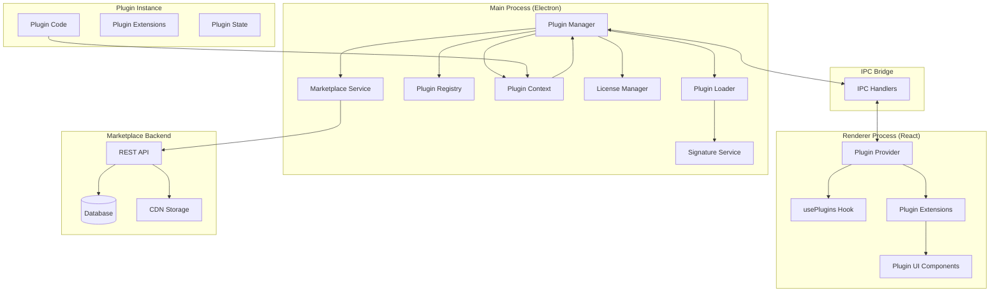

# Plugin System Architecture Analysis

> [!WARNING]
> **Historical document (February 2026).** Written before the plugin UI was moved into sandboxed iframes with a permission-gated bridge (July 2026). Architecture details below may no longer match the code — see [PLUGIN_ARCHITECTURE.md](./PLUGIN_ARCHITECTURE.md) for the current model.

## Kubernetes Desktop vs Odoo Module System

> [!NOTE]
> **Analysis Purpose**
>
> This document provides a comprehensive deep-dive analysis of the Kubernetes Desktop plugin system architecture and compares it with Odoo's renowned module system to identify architectural patterns, similarities, and opportunities for enhancement.

---

## Executive Summary

The Kubernetes Desktop project implements a **sophisticated hybrid plugin architecture** inspired by Odoo's modular design philosophy. Both systems share core principles:

- **Modular extensibility** - Self-contained packages that extend core functionality
- **Manifest-based metadata** - Declarative configuration files defining plugin/module capabilities
- **Dependency management** - Explicit declaration of dependencies between components
- **Lifecycle management** - Controlled activation, deactivation, and state management
- **Permission-based security** - Granular access control to system resources
- **Marketplace ecosystem** - Centralized distribution with free and paid offerings

---

## Architecture Comparison

### 1. Core Architecture Patterns

#### Odoo Module System

```
odoo-module/
├── __manifest__.py          # Module descriptor (metadata)
├── __init__.py              # Python package initialization
├── models/                  # Business logic & database models
├── views/                   # UI definitions (XML)
├── controllers/             # HTTP route handlers
├── security/                # Access control rules
├── data/                    # Initial/configuration data
└── static/                  # Frontend assets (JS, CSS, images)
```

**Key Characteristics:**

- **Three-tier architecture**: Presentation → Business Logic → Data
- **Python-centric**: Core logic in Python with XML for UI
- **ORM-based**: Built-in Object-Relational Mapping for database
- **Module inheritance**: Modules can inherit and extend other modules
- **Manifest file**: `__manifest__.py` with metadata (name, version, depends, data, etc.)

#### Kubernetes Desktop Plugin System

```
k8s-desktop-plugin/
├── plugin.json              # Plugin manifest (metadata)
├── index.js                 # Main entry point (Node.js)
├── ui/                      # React components
│   ├── PluginPage.tsx
│   └── ResourceAction.tsx
├── assets/                  # Icons, images
└── README.md                # Documentation
```

**Key Characteristics:**

- **Hybrid architecture**: Node.js (main process) + React (renderer process)
- **JavaScript/TypeScript**: Modern JS ecosystem with Electron
- **IPC-based**: Inter-Process Communication between main and renderer
- **Extension points**: Sidebar, pages, resource actions, notifications
- **Manifest file**: `plugin.json` with metadata (id, name, version, permissions, license, etc.)

### 2. Manifest/Descriptor Comparison

#### Odoo `__manifest__.py`

```python
{
    'name': 'My Module',
    'version': '1.0.0',
    'summary': 'Brief description',
    'description': 'Detailed description',
    'author': 'Author Name',
    'website': 'https://example.com',
    'category': 'Sales',
    'license': 'LGPL-3',
    'depends': ['base', 'sale'],  # Module dependencies
    'data': [                      # Data files to load
        'security/ir.model.access.csv',
        'views/views.xml',
        'data/data.xml',
    ],
    'demo': ['demo/demo.xml'],
    'installable': True,
    'application': True,
    'auto_install': False,
}
```

#### Kubernetes Desktop `plugin.json`

```json
{
  "id": "my-plugin",
  "name": "My Awesome Plugin",
  "version": "1.0.0",
  "description": "Adds cool features",
  "author": "Plugin Developer",
  "homepage": "https://example.com/my-plugin",
  "repository": "https://github.com/developer/my-plugin",
  "main": "index.js",
  "permissions": ["kubernetes", "ui"],
  "license": {
    "type": "paid",
    "spdx": "proprietary",
    "pricing": {
      "model": "subscription",
      "price": 9.99,
      "currency": "USD",
      "interval": "monthly",
      "trialDays": 14
    }
  },
  "marketplace": {
    "category": "monitoring",
    "tags": ["kubernetes", "monitoring"],
    "screenshots": ["assets/screenshot1.png"],
    "icon": "assets/icon.svg",
    "minAppVersion": "1.0.0"
  },
  "extensions": {
    "sidebar": [
      {
        "id": "my-page",
        "label": "My Plugin",
        "route": "/plugin/my-plugin"
      }
    ]
  }
}
```

**Comparison:**

| Feature           | Odoo                   | Kubernetes Desktop            |
| ----------------- | ---------------------- | ----------------------------- |
| **Format**        | Python dict            | JSON                          |
| **Dependencies**  | `depends` array        | Not yet implemented (planned) |
| **Data loading**  | `data` array (XML/CSV) | Not applicable                |
| **Licensing**     | Simple string          | Rich object with pricing      |
| **Marketplace**   | Separate metadata      | Built into manifest           |
| **UI Extensions** | XML views              | JSON extension points         |
| **Versioning**    | Simple string          | Semantic versioning           |

---

## 3. Plugin/Module Lifecycle

### Odoo Module Lifecycle

```
[Discovered] → [Installed] → [Activated] → [Running]
                    ↓            ↓
                [Updated]    [Deactivated]
                    ↓            ↓
                [Uninstalled] ←──┘
```

**Lifecycle Hooks:**

- `pre_init_hook()` - Before installation
- `post_init_hook()` - After installation
- `uninstall_hook()` - Before uninstallation
- `post_load()` - After module loading

### Kubernetes Desktop Plugin Lifecycle

```
[Discovered] → [Loaded] → [Enabled] → [Activated] → [Running]
                   ↓          ↓           ↓
              [Validated] [Disabled] [Deactivated]
                   ↓                      ↓
              [Error State]          [Unloaded]
                                         ↓
                                   [Uninstalled]
```

**Lifecycle Hooks:**

- `activate(context)` - Plugin activation with context API
- `deactivate()` - Plugin cleanup and deactivation

**States:**

- `discovered` - Found but not loaded
- `loaded` - Manifest validated, code loaded
- `enabled` - User enabled, ready to activate
- `active` - Currently running
- `disabled` - User disabled
- `error` - Failed validation or runtime error
- `trial` - Trial period active (for paid plugins)
- `expired` - License expired

---

## 4. Core System Components

### Kubernetes Desktop Plugin System Architecture



### Component Breakdown

#### 1. **Plugin Manager** (`plugin-manager.ts`)

**Role:** Orchestrates the entire plugin system

**Responsibilities:**

- Initialize plugin system on app startup
- Coordinate between loader, registry, and context
- Manage plugin lifecycle (enable, disable, reload)
- Handle plugin updates and version checking
- Watch plugin directories for changes (hot reload)
- Execute plugin actions and manage settings

**Key Methods:**

```typescript
initialize(): Promise<void>
enablePlugin(pluginId: string): Promise<void>
disablePlugin(pluginId: string): Promise<void>
activatePlugin(pluginId: string): Promise<void>
deactivatePlugin(pluginId: string): Promise<void>
reloadPlugin(pluginId: string): Promise<void>
checkForUpdates(): Promise<void>
uninstallPlugin(pluginId: string): Promise<void>
```

**Odoo Equivalent:** Module registry + Module loader combined

---

#### 2. **Plugin Loader** (`plugin-loader.ts`)

**Role:** Discovers and loads plugins from filesystem

**Responsibilities:**

- Scan plugin directories (`~/.kubernetes-desktop/plugins/`, bundled plugins)
- Read and validate `plugin.json` manifests
- Load plugin code (Node.js modules)
- Verify plugin signatures (security)
- Handle plugin errors gracefully
- Manage plugin code caching and cleanup

**Key Methods:**

```typescript
discoverPlugins(): Promise<Plugin[]>
loadPluginFromDirectory(path: string): Promise<Plugin | null>
validateManifest(manifest: PluginManifest): string | null
loadPluginCode(pluginId: string, path: string): Promise<any>
unloadPluginCode(pluginId: string): Promise<void>
```

**Odoo Equivalent:** Module loader (scans addons paths)

---

#### 3. **Plugin Registry** (`plugin-registry.ts`)

**Role:** Manages plugin state and configuration persistence

**Responsibilities:**

- Track all registered plugins
- Store plugin configuration (enabled/disabled, settings)
- Persist plugin state to disk (`plugin-config.json`)
- Encrypt sensitive data (license keys)
- Manage plugin contexts (runtime instances)
- Provide plugin lookup and query methods

**Key Methods:**

```typescript
registerPlugin(plugin: Plugin, config?: PluginConfig): Promise<void>
unregisterPlugin(pluginId: string): Promise<void>
getPlugin(pluginId: string): PluginRegistryEntry | undefined
getAllPlugins(): Plugin[]
getEnabledPlugins(): Plugin[]
updatePluginConfig(pluginId: string, config: Partial<PluginConfig>): Promise<void>
updatePluginSettings(pluginId: string, settings: Record<string, any>): Promise<void>
```

**Odoo Equivalent:** Module registry (tracks installed modules)

---

#### 4. **Plugin Context** (`plugin-context.ts`)

**Role:** Provides controlled API access to plugins

**Responsibilities:**

- Create isolated context for each plugin
- Expose safe API surface (Kubernetes, UI, Storage, Logger, Events)
- Enforce permission checks
- Prevent unauthorized access to system resources
- Provide plugin-specific storage
- Handle plugin-to-app communication

**API Surface:**

```typescript
context.kubernetes.getResources(type, namespace);
context.kubernetes.createResource(manifest);
context.kubernetes.updateResource(type, name, manifest);
context.kubernetes.deleteResource(type, name, namespace);
context.kubernetes.executeCommand(pod, namespace, command);
context.kubernetes.watchResources(type, callback);

context.ui.registerSidebarItem(item);
context.ui.registerPage(route, component);
context.ui.registerResourceAction(resourceType, action);
context.ui.showNotification(message, type);
context.ui.openModal(component, props);

context.storage.get(key);
context.storage.set(key, value);
context.storage.delete(key);
context.storage.clear();

context.logger.info(message, ...args);
context.logger.warn(message, ...args);
context.logger.error(message, ...args);
context.logger.debug(message, ...args);

context.events.on(event, handler);
context.events.off(event, handler);
context.events.emit(event, ...args);
```

**Odoo Equivalent:** Environment object (`env`) - provides access to models, database, context

---

#### 5. **License Manager** (`license-manager.ts`)

**Role:** Handles plugin licensing and monetization

**Responsibilities:**

- Validate license keys for paid plugins
- Check license expiration and subscription status
- Handle trial period activation
- Store encrypted license data locally
- Communicate with license server
- Prevent license key sharing
- Support offline validation (grace period)

**Odoo Equivalent:** Odoo Enterprise licensing (proprietary, not in community edition)

---

#### 6. **Marketplace Service** (`marketplace-service.ts`)

**Role:** Connects to marketplace backend

**Responsibilities:**

- Fetch plugin catalog from marketplace
- Download plugin packages
- Verify plugin signatures and checksums
- Handle plugin installation from marketplace
- Check for plugin updates
- Submit usage analytics (with consent)
- Manage plugin ratings and reviews

**Odoo Equivalent:** Odoo Apps Store client

---

#### 7. **Plugin Provider** (`PluginProvider.tsx`)

**Role:** React context provider for plugins

**Responsibilities:**

- Fetch plugins from main process via IPC
- Manage plugin state in React
- Provide hooks for components (`usePlugins`, `usePluginExtensions`)
- Handle plugin UI registration
- Trigger plugin lifecycle events from UI

**Odoo Equivalent:** Web client module loader

---

## 5. Extension Points & APIs

### Kubernetes Desktop Extension Points

| Extension Point      | Description                        | Example Use Case          |
| -------------------- | ---------------------------------- | ------------------------- |
| **Sidebar Items**    | Add navigation items to sidebar    | Plugin dashboard page     |
| **Pages**            | Register new routes/pages          | Custom resource viewer    |
| **Resource Actions** | Add action buttons to resources    | Quick restart pod button  |
| **Notifications**    | Show toast messages                | Alert on resource changes |
| **Modals**           | Open dialog windows                | Configuration wizard      |
| **Storage**          | Plugin-specific persistent storage | Save user preferences     |
| **Events**           | Subscribe to app events            | React to cluster changes  |

### Odoo Extension Points

| Extension Point       | Description                          | Example Use Case          |
| --------------------- | ------------------------------------ | ------------------------- |
| **Models**            | Define database models (ORM)         | Customer, Product, Order  |
| **Views**             | Define UI views (form, list, kanban) | Customer form view        |
| **Actions**           | Define user actions                  | Open wizard, print report |
| **Menus**             | Add menu items                       | Sales → Customers         |
| **Controllers**       | HTTP route handlers                  | REST API endpoints        |
| **Wizards**           | Multi-step dialogs                   | Import wizard             |
| **Reports**           | PDF/HTML reports                     | Invoice PDF               |
| **Scheduled Actions** | Cron jobs                            | Daily email digest        |
| **Workflows**         | Business process automation          | Order approval flow       |

**Key Difference:** Odoo has deeper integration with database and business logic, while Kubernetes Desktop focuses on UI extensions and Kubernetes API interactions.

---

## 6. Security & Permissions

### Kubernetes Desktop Permission System

**Permission Types:**

- `kubernetes` - Access to Kubernetes API
- `ui` - Register UI extensions
- `notifications` - Show notifications
- `filesystem` - File system access (future)
- `network` - Network requests (future)

**Security Measures:**

- Manifest-based permission declaration
- Plugin signing and verification (RSA)
- Signature validation before loading
- Sandboxed plugin execution
- User approval for sensitive operations
- Encrypted license storage

### Odoo Security Model

**Access Control:**

- **Groups**: User groups with specific permissions
- **Access Rights**: Model-level CRUD permissions (create, read, update, delete)
- **Record Rules**: Row-level security (filter records based on conditions)
- **Field-level Security**: Hide/show fields based on groups

**Security Files:**

- `ir.model.access.csv` - Model access rights
- `security.xml` - Groups and record rules

**Key Difference:** Odoo has more granular, database-centric security, while Kubernetes Desktop focuses on API-level permissions.

---

## 7. Licensing & Monetization

### Kubernetes Desktop Licensing

**License Types:**

- **Free** - Open-source (MIT, Apache-2.0, LGPL-3)
- **Paid** - Commercial with licensing
- **Trial** - Time-limited trial period
- **Subscription** - Recurring payments (monthly/yearly)
- **Freemium** - Basic free, premium paid

**Pricing Models:**

- One-time purchase per installation
- Subscription (monthly/yearly)
- Freemium (basic free, premium paid)
- Enterprise licensing (volume discounts)

**License Management:**

- License key activation
- Online/offline validation
- Trial period tracking
- Expiration handling
- Installation ID binding
- License transfer/deactivation

### Odoo Licensing

**License Types:**

- **Community Edition** - LGPL-3 (free, open-source)
- **Enterprise Edition** - Proprietary (paid, per-user pricing)
- **OPL-1** - Odoo Proprietary License (for apps)

**Pricing:**

- Per-user subscription (monthly/yearly)
- Different pricing tiers (Standard, Custom)
- Free community edition with limitations

**Key Similarity:** Both support free and paid models with marketplace distribution.

---

## 8. Marketplace Architecture

### Kubernetes Desktop Marketplace

**Frontend (Desktop App):**

- Plugin Store page (`PluginStore.tsx`)
- Browse, search, filter plugins
- Plugin details with screenshots
- Install/purchase flow
- License activation UI

**Backend (Marketplace Service):**

- RESTful API for plugin catalog
- Plugin upload and publishing
- Payment processing (Stripe, PayPal)
- License key generation
- Download tracking and analytics
- Review and rating system
- Plugin version management

**Database Schema:**

- Plugins table (metadata, pricing, downloads, ratings)
- Users table (developers, customers)
- Licenses table (activation keys, expiration)
- Reviews table (ratings, comments)
- Transactions table (purchases, refunds)

### Odoo Apps Store

**Frontend (Web):**

- Browse apps by category
- Search and filter
- App details with screenshots
- Install from web interface
- Rating and reviews

**Backend:**

- Centralized app repository
- Automatic updates
- Version compatibility checking
- Community and enterprise apps
- Payment processing for paid apps

**Key Similarity:** Both have centralized marketplaces with free/paid apps, ratings, and automatic updates.

---

## 9. Developer Experience

### Kubernetes Desktop Plugin Development

**Getting Started:**

1. Enable Developer Mode in settings
2. Create plugin directory: `~/.kubernetes-desktop/plugins/my-plugin/`
3. Create `plugin.json` manifest
4. Create `index.js` with `activate()` and `deactivate()` functions
5. Reload app to load plugin

**Development Tools:**

- Hot reload (file watcher)
- Developer console (Electron DevTools)
- Plugin generator (planned CLI tool)
- Example plugins
- Comprehensive documentation

**Testing:**

- Unit tests with Vitest
- Manual testing in app
- Mock context for testing

### Odoo Module Development

**Getting Started:**

1. Create module directory in addons path
2. Create `__manifest__.py` and `__init__.py`
3. Define models, views, controllers
4. Install module from Apps menu
5. Restart server to reload

**Development Tools:**

- Odoo CLI (scaffold, shell, test)
- Debug mode (developer tools)
- XML/Python hot reload
- Extensive documentation
- Community forums

**Testing:**

- Unit tests (Python unittest)
- Integration tests
- Tour tests (JS-based UI tests)

**Key Similarity:** Both provide scaffolding tools, hot reload, and comprehensive documentation.

---

## 10. Key Architectural Patterns

### Shared Patterns

| Pattern                     | Kubernetes Desktop         | Odoo                       |
| --------------------------- | -------------------------- | -------------------------- |
| **Modular Architecture**    | ✅ Self-contained plugins  | ✅ Self-contained modules  |
| **Manifest-based Metadata** | ✅ `plugin.json`           | ✅ `__manifest__.py`       |
| **Lifecycle Management**    | ✅ activate/deactivate     | ✅ install/uninstall hooks |
| **Dependency Management**   | ⚠️ Planned                 | ✅ `depends` array         |
| **Extension Points**        | ✅ Sidebar, pages, actions | ✅ Models, views, menus    |
| **Permission System**       | ✅ Manifest-based          | ✅ Groups & access rights  |
| **Marketplace**             | ✅ Built-in                | ✅ Odoo Apps Store         |
| **Free & Paid Models**      | ✅ Licensing system        | ✅ Community & Enterprise  |
| **Hot Reload**              | ✅ File watcher            | ✅ Developer mode          |
| **Versioning**              | ✅ Semantic versioning     | ✅ Version strings         |

### Unique to Kubernetes Desktop

- **Hybrid Architecture** - Electron (Node.js + React)
- **IPC Communication** - Main ↔ Renderer process
- **Kubernetes-specific APIs** - Native K8s integration
- **Plugin Signing** - RSA signature verification
- **Trial Periods** - Built-in trial management
- **Offline Licensing** - Grace period for offline validation

### Unique to Odoo

- **ORM (Object-Relational Mapping)** - Database abstraction
- **XML-based UI** - Declarative view definitions
- **Workflow Engine** - Business process automation
- **Multi-company** - Built-in multi-tenancy
- **Internationalization** - Built-in translation system
- **Scheduled Actions** - Cron job system
- **Inheritance System** - Modules can inherit and extend others

---

## 11. Recommendations for Enhancement

Based on Odoo's proven architecture, here are recommendations to enhance the Kubernetes Desktop plugin system:

### 1. **Implement Plugin Dependencies**

**Current State:** Not implemented  
**Odoo Pattern:** `depends` array in manifest

**Recommendation:**

```json
{
  "id": "my-plugin",
  "dependencies": {
    "core-monitoring": "^1.0.0",
    "ui-toolkit": ">=2.0.0 <3.0.0"
  }
}
```

**Benefits:**

- Plugins can build on each other
- Automatic dependency resolution
- Version compatibility checking
- Prevents broken installations

---

### 2. **Add Plugin Inheritance/Extension**

**Current State:** Plugins are isolated  
**Odoo Pattern:** Modules can inherit and extend other modules

**Recommendation:**

```json
{
  "id": "enhanced-monitoring",
  "extends": "core-monitoring",
  "overrides": {
    "sidebar": [
      {
        "id": "monitoring-dashboard",
        "label": "Enhanced Dashboard"
      }
    ]
  }
}
```

**Benefits:**

- Customize existing plugins without forking
- Incremental enhancements
- Better code reuse

---

### 3. **Introduce Plugin Data Loading**

**Current State:** No data loading mechanism  
**Odoo Pattern:** `data` array in manifest for XML/CSV files

**Recommendation:**

```json
{
  "id": "my-plugin",
  "data": ["data/default-config.json", "data/sample-dashboards.json"]
}
```

**Benefits:**

- Seed initial configuration
- Provide sample data
- Easier plugin setup

---

### 4. **Add Scheduled Tasks/Cron Jobs**

**Current State:** Not implemented  
**Odoo Pattern:** Scheduled actions (cron jobs)

**Recommendation:**

```typescript
context.scheduler.register({
  id: 'cleanup-task',
  cron: '0 0 * * *', // Daily at midnight
  handler: async () => {
    // Cleanup logic
  },
});
```

**Benefits:**

- Background tasks (cleanup, sync, alerts)
- Periodic health checks
- Automated maintenance

---

### 5. **Implement Plugin Hooks/Events**

**Current State:** Basic event system  
**Odoo Pattern:** Extensive hook system (pre/post install, model CRUD hooks)

**Recommendation:**

```typescript
// Plugin lifecycle hooks
{
  beforeActivate: async (context) => { /* setup */ },
  afterActivate: async (context) => { /* post-setup */ },
  beforeDeactivate: async (context) => { /* cleanup */ },
  afterDeactivate: async (context) => { /* post-cleanup */ }
}

// App event hooks
context.hooks.on('cluster:connected', async (cluster) => {
  // React to cluster connection
});

context.hooks.on('resource:created', async (resource) => {
  // React to resource creation
});
```

**Benefits:**

- Fine-grained lifecycle control
- React to app events
- Better integration points

---

### 6. **Add Plugin Configuration UI**

**Current State:** Manual settings object  
**Odoo Pattern:** Automatic settings UI from manifest

**Recommendation:**

```json
{
  "configuration": {
    "title": "Plugin Settings",
    "properties": {
      "apiKey": {
        "type": "string",
        "label": "API Key",
        "description": "Your API key for external service",
        "secret": true,
        "required": true
      },
      "refreshInterval": {
        "type": "number",
        "label": "Refresh Interval (seconds)",
        "default": 30,
        "min": 10,
        "max": 300
      },
      "enableNotifications": {
        "type": "boolean",
        "label": "Enable Notifications",
        "default": true
      }
    }
  }
}
```

**Benefits:**

- Auto-generated settings UI
- Type validation
- Better UX for plugin configuration

---

### 7. **Implement Plugin Translations (i18n)**

**Current State:** Not implemented  
**Odoo Pattern:** `i18n/` directory with `.po` files

**Recommendation:**

```
my-plugin/
├── i18n/
│   ├── en.json
│   ├── es.json
│   └── fr.json
```

```typescript
context.i18n.t('plugin.message.welcome'); // "Welcome to the plugin"
```

**Benefits:**

- Multi-language support
- Better accessibility
- Wider user base

---

### 8. **Add Plugin Testing Framework**

**Current State:** Manual testing  
**Odoo Pattern:** Built-in test framework

**Recommendation:**

```typescript
// tests/plugin.test.ts
import { createMockContext } from '@k8s-desktop/plugin-testing';

describe('My Plugin', () => {
  it('should register sidebar item', async () => {
    const context = createMockContext();
    await plugin.activate(context);
    expect(context.ui.registerSidebarItem).toHaveBeenCalled();
  });
});
```

**Benefits:**

- Automated testing
- Quality assurance
- Regression prevention

---

### 9. **Implement Plugin Sandboxing**

**Current State:** Basic permission checks  
**Odoo Pattern:** Python security model

**Recommendation:**

- Run plugins in separate processes (worker threads)
- Strict API boundaries
- Resource limits (CPU, memory)
- Network request filtering

**Benefits:**

- Prevent malicious plugins
- Isolate plugin crashes
- Better security

---

### 10. **Add Plugin Analytics & Telemetry**

**Current State:** Not implemented  
**Odoo Pattern:** Usage analytics in Apps Store

**Recommendation:**

```typescript
context.analytics.track('feature_used', {
  feature: 'quick-restart',
  resourceType: 'pod',
});
```

**Benefits:**

- Understand plugin usage
- Improve plugin quality
- Data-driven development

---

## 12. Implementation Roadmap

### Phase 1: Core Enhancements (2-3 weeks)

- ✅ Plugin dependencies
- ✅ Plugin data loading
- ✅ Enhanced configuration UI
- ✅ Plugin hooks/events

### Phase 2: Developer Experience (2-3 weeks)

- ✅ Plugin CLI tool (scaffold, build, sign, publish)
- ✅ Testing framework
- ✅ i18n support
- ✅ Better documentation

### Phase 3: Advanced Features (3-4 weeks)

- ✅ Plugin inheritance/extension
- ✅ Scheduled tasks
- ✅ Enhanced sandboxing
- ✅ Analytics & telemetry

### Phase 4: Marketplace Maturity (4-6 weeks)

- ✅ Full marketplace backend
- ✅ Payment processing
- ✅ Developer portal
- ✅ Review & approval workflow

---

## 13. Conclusion

The Kubernetes Desktop plugin system is **architecturally sound** and shares many proven patterns with Odoo's module system:

### Strengths

✅ **Hybrid architecture** - Leverages Electron for desktop integration  
✅ **Modern tech stack** - TypeScript, React, Node.js  
✅ **Comprehensive licensing** - Free, paid, trial, subscription models  
✅ **Security-first** - Plugin signing, permissions, encryption  
✅ **Developer-friendly** - Hot reload, good documentation  
✅ **Marketplace-ready** - Built-in marketplace integration

### Areas for Improvement

⚠️ **Plugin dependencies** - Not yet implemented  
⚠️ **Plugin inheritance** - Would enable better extensibility  
⚠️ **Data loading** - Would simplify plugin setup  
⚠️ **Scheduled tasks** - Would enable background automation  
⚠️ **i18n support** - Would expand global reach  
⚠️ **Advanced sandboxing** - Would improve security

### Final Assessment

The Kubernetes Desktop plugin system is **well-designed and production-ready** for its current scope. By adopting additional patterns from Odoo (dependencies, inheritance, data loading, scheduled tasks), it can evolve into an even more powerful and flexible ecosystem.

The architecture demonstrates:

- **Solid engineering** - Clean separation of concerns
- **Scalability** - Can handle hundreds of plugins
- **Extensibility** - Multiple extension points
- **Security** - Permission-based access control
- **Monetization** - Built-in licensing and marketplace

**Recommendation:** Proceed with current architecture and incrementally add enhancements from the roadmap based on user feedback and marketplace demand.

---

## Appendix: File Structure Reference

### Current Plugin System Files

**Main Process (Electron):**

- `electron/types/plugin-types.ts` - Type definitions
- `electron/services/plugins/plugin-manager.ts` - Orchestration
- `electron/services/plugins/plugin-loader.ts` - Discovery & loading
- `electron/services/plugins/plugin-registry.ts` - State management
- `electron/services/plugins/plugin-context.ts` - API surface
- `electron/services/security/license-manager.ts` - Licensing
- `electron/services/security/signature-service.ts` - Signing
- `electron/services/marketplace/marketplace-service.ts` - Marketplace client

**Renderer Process (React):**

- `src/features/plugins/PluginProvider.tsx` - React context
- `src/features/plugins/PluginRuntime.tsx` - Runtime UI
- `src/features/plugins/LicenseActivationModal.tsx` - License UI
- `src/features/plugins/PluginSettingsModal.tsx` - Settings UI
- `src/pages/Plugins.tsx` - Plugin management page
- `src/pages/PluginPage.tsx` - Plugin detail page

**Marketplace Backend:**

- `marketplace-backend/src/services/plugin-catalog.ts` - Catalog service
- `marketplace-backend/src/index.ts` - API server
- `marketplace-backend/public/catalog.json` - Plugin catalog

**Documentation:**

- `docs/PLUGIN_ARCHITECTURE.md` - Architecture documentation
- `docs/PLUGINS_GUIDE.md` - Developer guide

**Example Plugins:**

- `plugins/namespace-watcher/` - Example monitoring plugin

---

**Document Version:** 1.0  
**Last Updated:** 2026-02-02  
**Author:** AI Analysis System
